# Showcase

The examples that come with Oxygen (Examples menu), next to Snowstorm and next to the game.

## Oxygen, Snowstorm and Minecraft

Each example was played in Minecraft 26.50 and in Oxygen from the same camera.

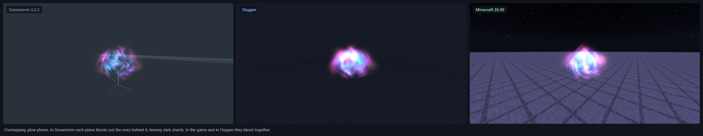
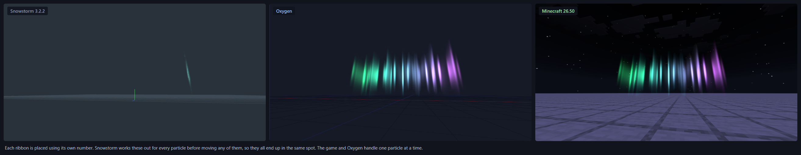
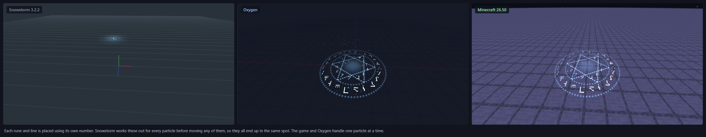
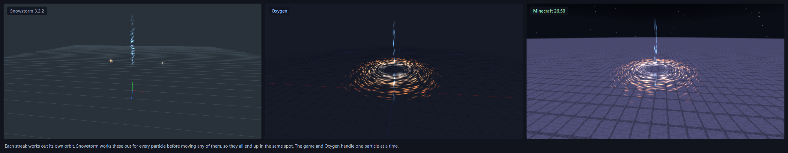
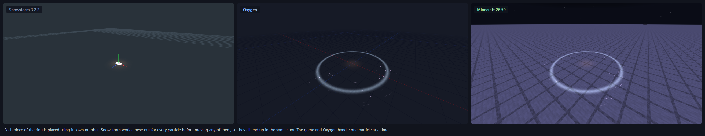
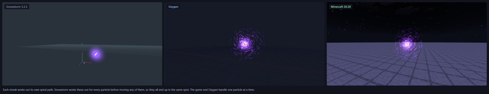

## Oxygen and Snowstorm

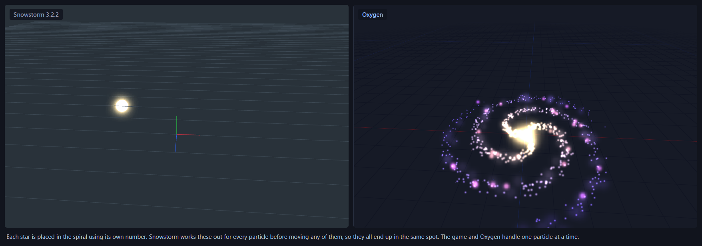
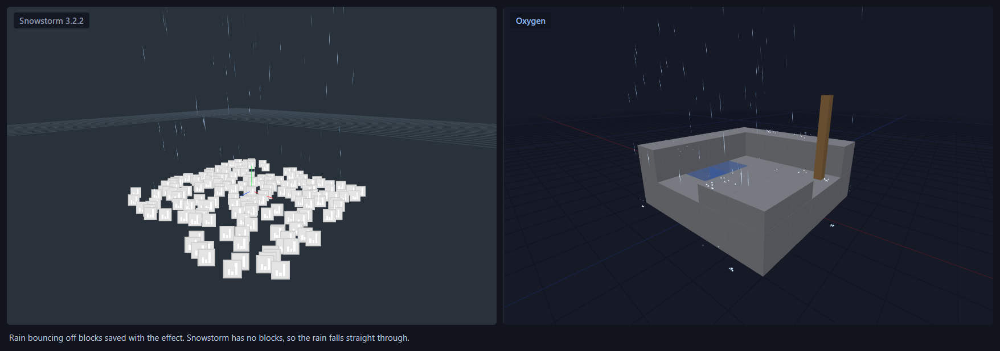
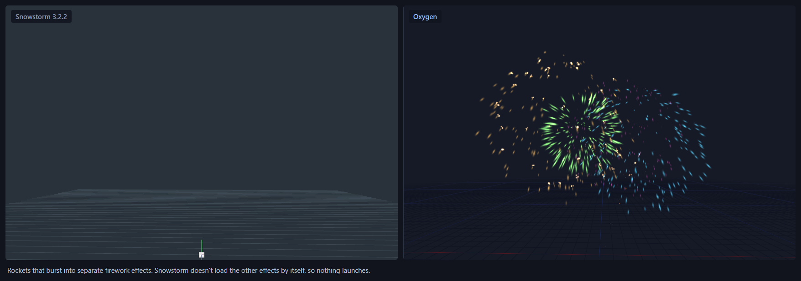
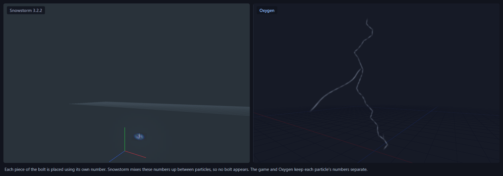
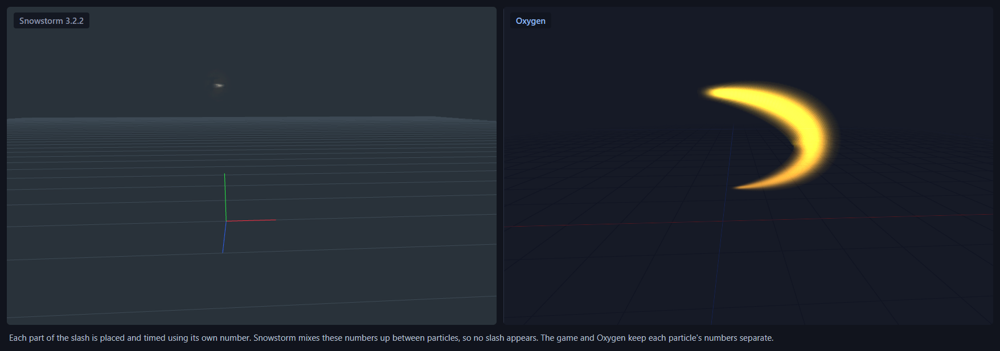
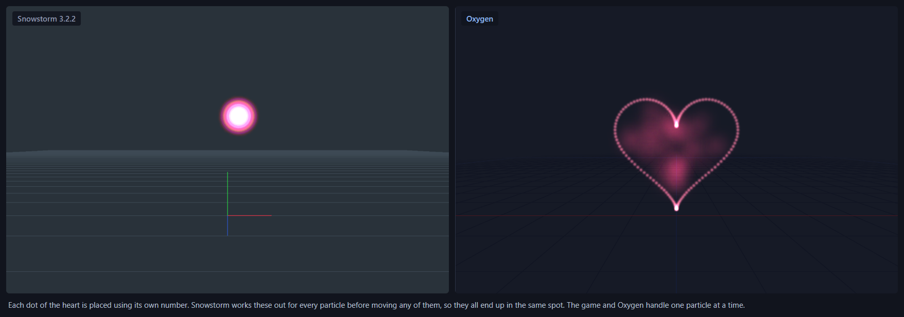
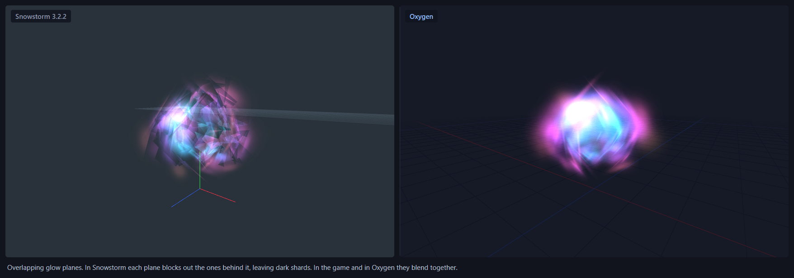

## In motion

| | |
| --- | --- |
| 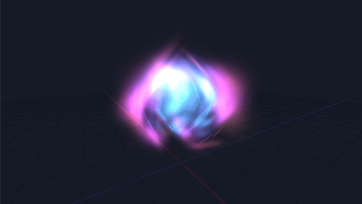 | 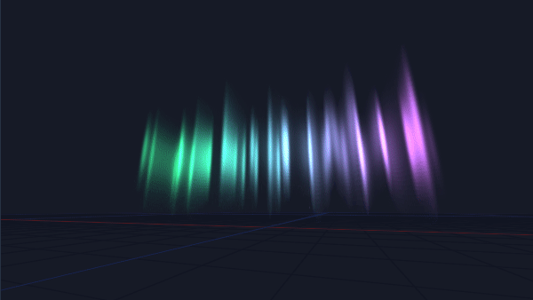 |
| 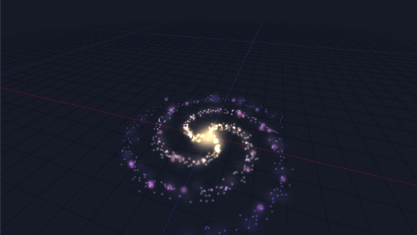 | 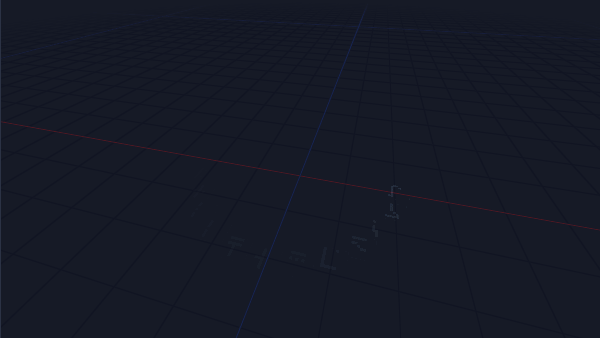 |
| 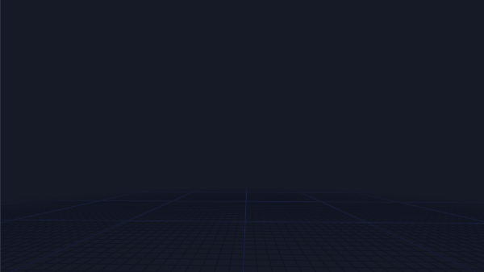 | 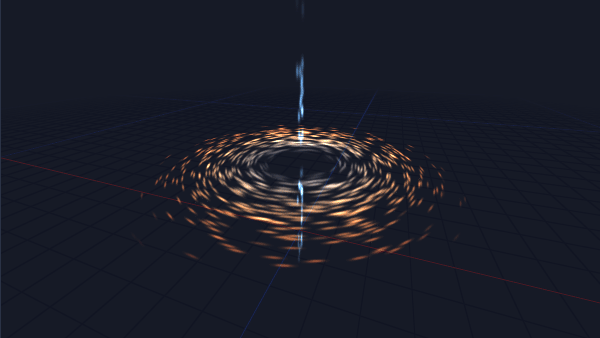 |
| 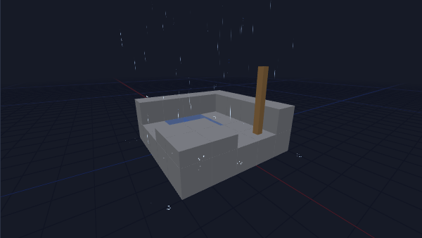 | 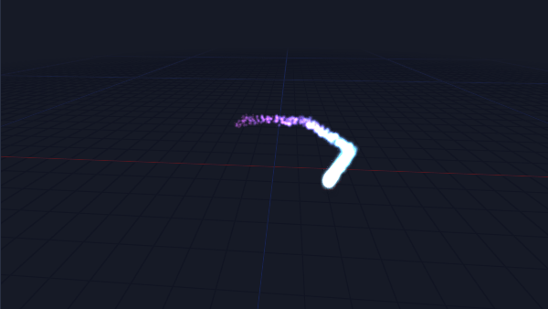 |
| 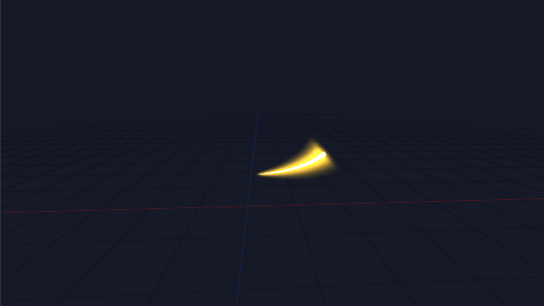 | 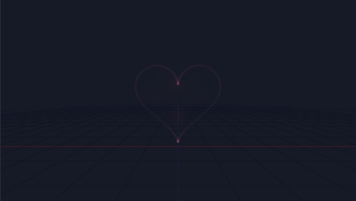 |

The same effects in Minecraft:

| | |
| --- | --- |
| 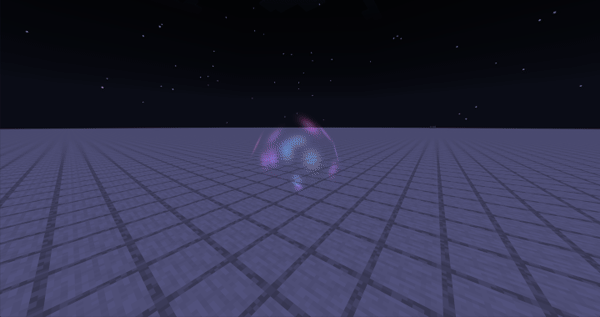 | 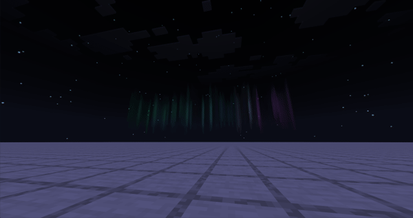 |
| 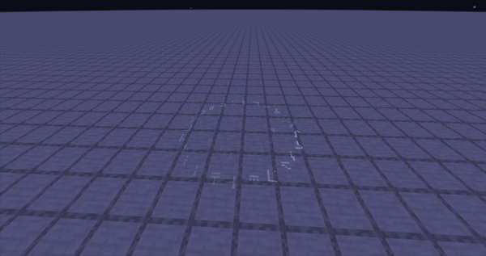 | 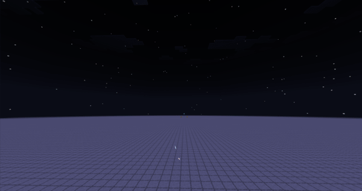 |

## The editor

Scenarios in the Context panel hand the effect the values a script or entity would:
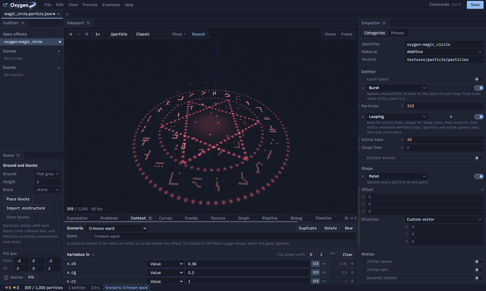

Curves, here a keyed Bézier chain that makes the heartbeat snap:
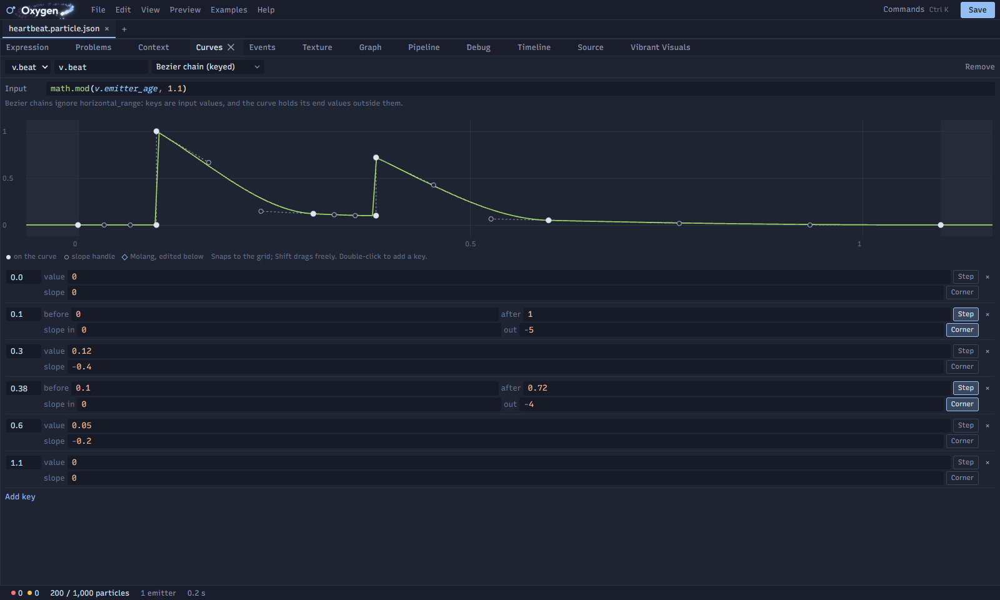

Events across effects: the launcher's timeline, the rocket it spawns and the bursts the rocket fires:
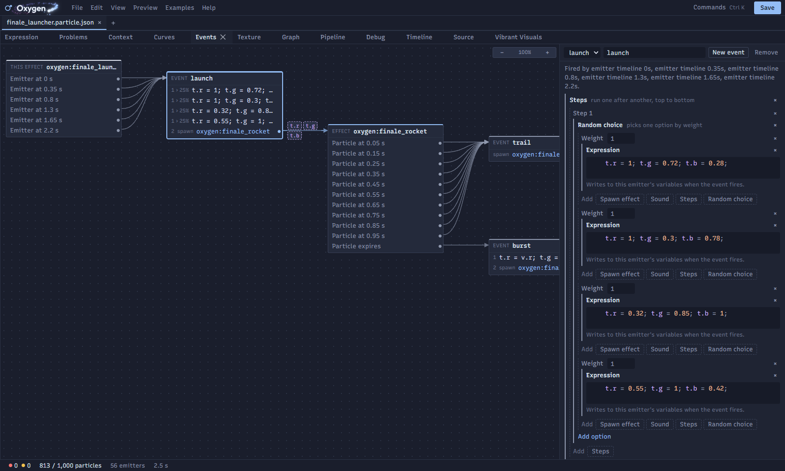

The texture, with outlines where live particles sample it:
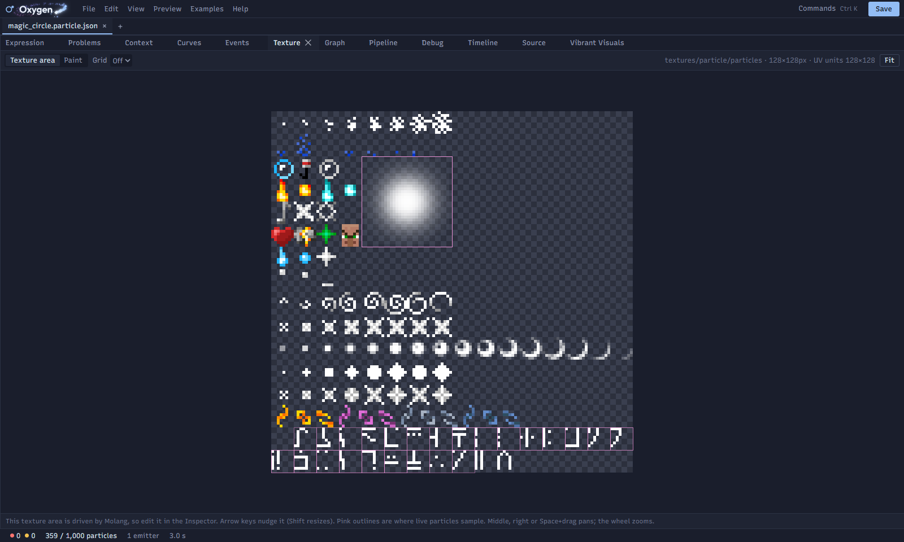

The order everything runs in, with lines from where each value is set to where it's read:
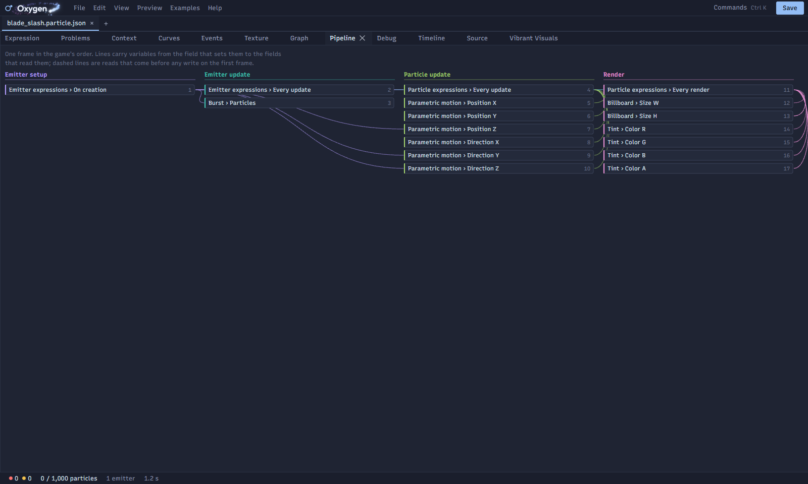

Classic and Vibrant Visuals side by side, with the glow settings:
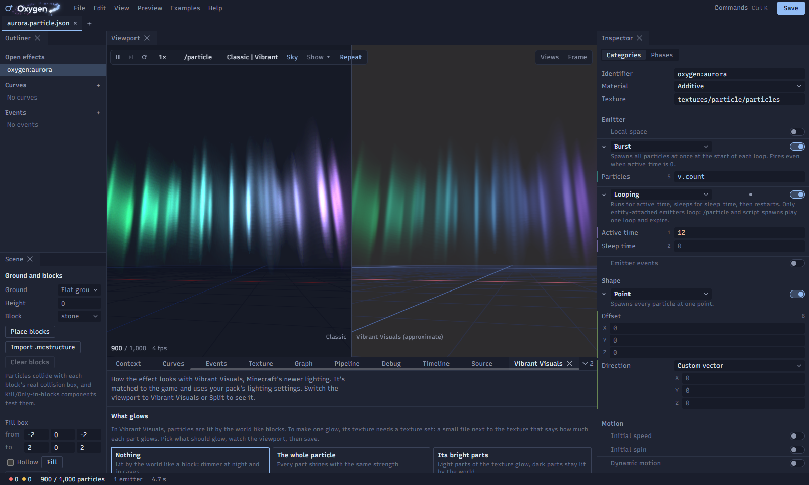
